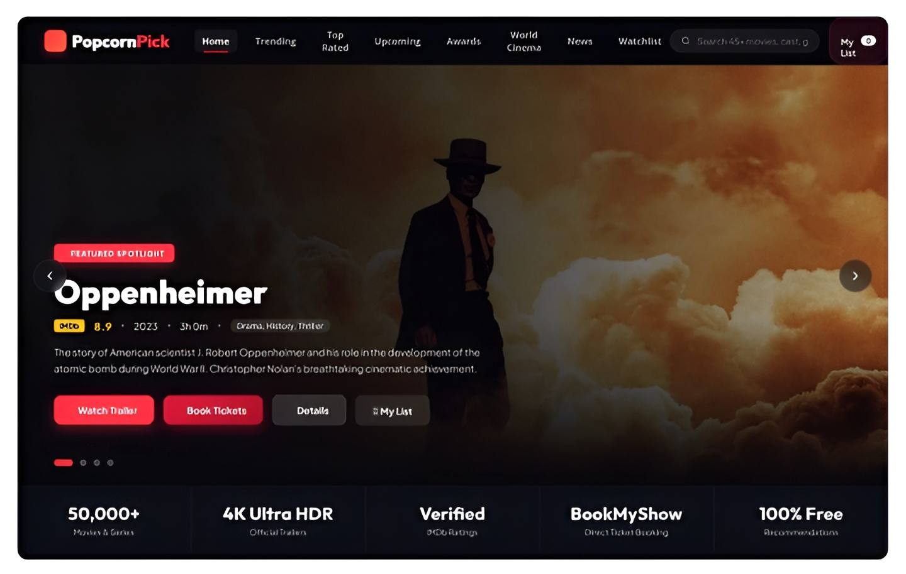

# 🍿 PopcornPick

> Pick a movie you love, and PopcornPick finds your next favorite.

PopcornPick is a movie recommendation web app that suggests films based on your taste, <br> so you spend less time scrolling and more time watching.

## ✨ Features

- 🎬 **Smart Recommendations:** Personalized suggestions based on the movie you select
- 🔍 **Easy Search:** Quickly find and explore movies
- ⚡ **Fast & Responsive:** Clean, modern UI that works on any screen

## 🚀 Tech Stack

- **Frontend:** HTML, CSS, JavaScript
- **Data:** Movie database API

## 📸 Preview

<p align="center">
  
</p>

## 🛠️ Getting Started

```bash
# Clone the repository
git clone https://github.com/index-oss/PopcornPick.git

# Go to the project folder
cd PopcornPick

# Run the app
# Open index.html in your browser
```

## 🤝 Contributing

Contributions, issues, and feature requests are welcome. Feel free to open an issue or submit a pull request.

## 📝 License

Distributed under the MIT License.
